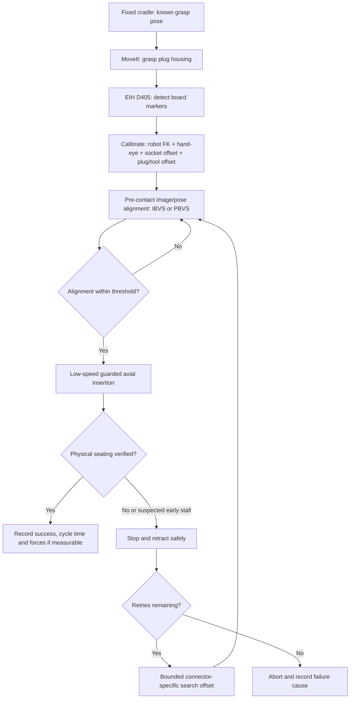

# Research Master File — Vision- and Learning-Based Robotic Insertion

**Scope:** electrical connector mating, cable/flat-cable insertion, and closely related peg-in-hole / plug-socket insertion **only when the paper uses IBVS, PBVS, another vision-guided approach, reinforcement learning, imitation learning, or another learned perception/control method.**  
**Research cutoff:** 1 November 2026. **Purpose:** Vision-Based Manipulation project using a Kinova Gen3 Lite, a two-finger gripper, one eye-in-hand Intel RealSense D405, a repeatable connector cradle, and a static socket board.  
**Status:** curated, source-linked literature map, **not an exhaustive census** of every publication. Each entry distinguishes the source's reported setup from our interpretation of its applicability.

## How to use this document

- **Start with the [comparison table](#comparison-at-a-glance), then read the [priority papers](#ten-papers-to-read-first).**
- The tag **IBVS** is used only where the controller explicitly minimizes *image-feature* errors. **PBVS** refers to estimated 3D pose error. A paper that uses a camera or learned detector is **not automatically IBVS/PBVS**; it may use visual pose estimation followed by feed-forward motion, or another visual policy.
- **Learned perception ≠ learned controller.** A CNN estimating socket pose with a classical impedance controller is a hybrid vision/learning system, not RL insertion.
- **Code status:** “verified” means an identifiable official repository or official implementation page is linked. “Not verified” does **not** prove code is unavailable. A project video or downloadable dataset is not automatically implementation code.
- **Comparison warning:** reported success rates are not comparable without matching part clearance, socket tolerances, perturbation distribution, sensors, stopping rules, and trial counts.
- **Original project constraints:** an eye-in-hand camera need not observe the robot itself; forward kinematics plus calibrated hand-eye and plug-to-gripper transforms link the socket measurement to the end effector. Without a wrist force/torque sensor, published force-controlled insertion methods cannot be copied directly.

## Legend

| Mark | Meaning |
|---|---|
| **Cable / plug** | Real electrical connector, wiring terminal, or flexible cable insertion |
| **Peg** | Generic rigid peg-in-hole assembly |
| **IBVS / PBVS** | Explicit image-space / reconstructed-pose visual servoing |
| **Visual alignment / pose** | Uses vision, but not necessarily a closed-loop servo controller |
| **RL / residual RL / IL** | Learned action policy, possibly combined with classical control |
| **Learned perception** | Vision model identifies features/pose; insertion may remain classical |
| **F/T needed** | Source uses a force/torque sensor; not a ready baseline for Gen3 Lite |

## Ten papers to read first

1. **Song et al. (2017)** — connector feeder + marker-based EIH vision + impedance control; closest mechanical setup.
2. **Shen et al. (2023)** — wrist-camera landmarks + IBVS + spiral search + force control; strongest staged insertion template.
3. **Mou et al. (2022)** — real industrial cable insertion; YOLO and pin-layout pose estimation + admittance control.
4. **Zhang et al. (2023)** — single in-hand RGB-D camera; 6D socket pose for RJ45/HDMI.
5. **Haugaard et al. (CoRL 2020 / PMLR 2021)** — continuous relative peg-hole visual servoing and a strong comparison against search.
6. **Xie et al. (2022/2023)** — seam-based, simulation-trained visual alignment with EIH evaluation and public code.
7. **Schoettler et al. (2019)** — real industrial insertion with visual RL and natural rewards, enabled by priors.
8. **Marougkas et al. (2025)** — a model-based insertion controller plus bounded residual RL under noisy pose estimates.
9. **SHaRe-RL (ICRA 2026)** — actual industrial Harting connector insertion, human corrections, structured primitives, force constraints.
10. **Park et al. (2025)** — directly addresses *deformable flat-cable* insertion via image-based RL and sim-to-real segmentation.

---

## Comparison at a glance

| ID | Paper (year) | Insertion task | Sensing / mounting | Actual approach | Contact instrumentation | Official/public code |
|---|---|---|---|---|---|---|
| V01 | Song et al. (2015) | USB cable | Camera + industrial arm | Visual servo + impedance | Wrist F/T | Not verified |
| V02 | Song et al. (2017) | Electrical connector | EIH camera + markers | Visual servo + tilting/impedance | Wrist F/T | Not verified |
| V03 | Triyonoputro et al. (2019) | Peg | Two in-hand cameras | Learned visual servo + spiral + impedance | Wrist F/T | Not verified |
| V04 | Haugaard et al. (2021) | Peg | Multiple cameras | Learned peg/hole points + continuous visual servo | Final compliant stage | Not verified |
| V05 | Puang et al. (2020) KOVIS | Peg insertion and fine manipulation | EIH stereo; UR5 + D435 | Learned keypoint visual servo | Not the main emphasis | [Verified](https://github.com/enyen/KOVIS_VisualServo) |
| V06 | Lian et al. (2021) | USB, RJ45, D-sub etc. | Industrial vision/force solutions | Vision-first industrial assembly baselines | Varies by baseline | Not verified |
| V07 | Cirillo et al. (2021) | Switchgear wire insertion | RGB/stereo geometry | Learned label recognition + visual wire pose | Not established | Not verified |
| V08 | Mou et al. (2022) | Aeronautical cable connectors | Camera + UR5e | Two YOLOs + pin-layout pose + admittance | Contact-force control | Not verified |
| V09 | Shen et al. (2023) | D-sub connector | Wrist D435 | Learned landmarks + IBVS + spiral + force insertion | Wrist F/T | Not verified |
| V10 | Zhang et al. (2023) | RJ45 / HDMI | In-hand RGB-D + KUKA iiwa | Learned detector + geometric 6D PBVS-like alignment | Compliant insertion | Not verified |
| V11 | Xie et al. (2022) | Peg, unseen shapes | Camera vision | Learned seam representation + closed-loop policy | Vision-centric | [Verified](https://github.com/xieliang555/SFN) |
| V12 | Xie et al. (2023) | Peg + EV charging plug | EIH and eye-to-hand | Segmentation + virtual pose sensor + controller net | Vision-centric | [Verified project repo](https://github.com/xieliang555/SFN) |
| V13 | Zou et al. (2026) | Connector assembly | Eye-in-hand | Classical segmented IBVS + graph matching | No wrist F/T claimed in abstract | Not verified |
| R01 | Vecerik et al. (2018/19) | Peg / deformable clip | Raw images + robot feedback | Demonstration-augmented DDPG | Haptic interaction | Not verified |
| R02 | Schoettler et al. (2019) | Industrial plugs | Visual observations | Real-world RL + residual/demonstration priors | Task-dependent | Not verified |
| R03 | Schoettler et al. (2020) | Industrial inserts | Sim + real | Meta-RL, few-shot real adaptation | Task-dependent | Not verified |
| R04 | Beltran-Hernandez et al. (2020) | Peg | Uncertain nominal pose | SAC + adaptive force/position compliance | Wrist F/T | Generic RL library only |
| R05 | Luo et al. (2021) | NIST industrial assembly | Multi-modal | Demo-initialized RL vs engineered baseline | Multimodal | Not verified |
| R06 | Spector & Di Castro (2021) | 16 insertion tasks | Vision + force | Supervised regression correction | Force input | Not verified |
| R07 | Davchev et al. (2022) | Peg / gear / plug | Robot states + demonstrations | DMP + residual RL | Task-dependent | Project/videos |
| R08 | Spector et al. (2022) | 16 insertion tasks | Stereo/multiview + force | Contrastive features + regression / relation network | Force input | Not verified |
| R09 | Zhao et al. (2022) | Industrial inserts | Prior offline datasets | Offline meta-RL + adaptation | Task-dependent | Project/videos |
| R10 | Chen et al. (2022) | Visual insertion | Images | Visual RL + Real2Sim adaptation | Not established | Not verified |
| R11 | Tang et al. (2023) IndustReal | Peg/part insertion | Sim states + deployment signals | RL + SDF reward + curricula + smoothing | Depends on setup | [Verified](https://research.nvidia.com/publication/2023-05_industreal-transferring-contact-rich-assembly-tasks-simulation-reality) |
| R12 | Tang et al. (2024) AutoMate | Many peg/part geometries | Sim state + perception at deployment | Specialist and generalist RL policies | Depends on setup | [Verified](https://research.nvidia.com/publication/2024-07_automate-specialist-and-generalist-assembly-policies-over-diverse-geometries) |
| R13 | Luo et al. (2025) HIL-SERL | USB, RAM and other assembly | Wrist/other images + proprioception | Human-in-the-loop real-robot RL | Robot/task-dependent | [Verified](https://github.com/rail-berkeley/hil-serl) |
| R14 | Marougkas et al. (2025) | <1 mm plug-socket | RGB-D 6D tracking | Potential-field + residual RL | Pose tracking, controlled execution | Project page |
| R15 | Stranghöner et al. (2026) SHaRe-RL | Harting connector modules | Proprioception + force, task cues | Skill primitives + human-guided RL | Force feedback | [Official page/code](https://share-rl.github.io/share-rl.io/) |
| R16 | Kienle et al. (2025) | Wire-harness connector mating | Visual+tactile+proprioception | Multimodal learned optimization of control programs | Contact sensing | Project/videos |
| R17 | Park et al. (2025) | Flexible flat cable | Two EIH cameras + masks | Simulation SAC + SAM2/VLM visual transfer | No F/T claimed in summary | Not verified |
| R18 | Duan et al. (2025) | Cable-in-duct | Visual + tactile | Multi-stage RL and tactile sim-to-real adaptation | Tactile | Not verified |
| R19 | Yamaguchi et al. (2025) | Flat cable reaching for insertion | Camera + arm pose | Simulation deep RL + CycleGAN | Not primary study | Not verified |
| R20 | Zhao et al. (2026) PooH2PiH | Peg | Visual + tactile | RL disassembly → reversed trajectories → insertion learning | Tactile | Official demos/dataset; check repository |
| R21 | Azulay et al. (2025) | Peg/socket | External depth + fingertip tactile | Transformer teacher-student learned policy | Tactile | [Verified](https://github.com/osheraz/IsaacGymInsertion) |
| R22 | Xu et al. (2026) S2P | Polygon peg | Visual inputs | RL with separate location/insertion primitives | Force-constrained evaluation | Not verified |
| R23 | Efficient Online Contact Force Models (2025) | Electrical connector | Learned state/contact features | Online linear force model + optimized impedance | Measured forces | [Official project](https://model-based-plugging.github.io/) |
| R24 | Wu et al. (2025) TacDiffusion | Precision peg insertion | Tactile/contact data | Diffusion-generated wrench control | Tactile/force | [Official project/code](https://github.com/popnut123/TacDiffusion) |
| R25 | Learning Robotic Insertion Tasks From Human Demonstration (2023) | Peg | Hand pose from RGB-D | Human-demo latent skills + RL | Depends on experiment | Not verified |

---

# A. Vision-guided insertion, IBVS/PBVS, and learned visual alignment

## V01. Song, Kim & Song — USB Assembly Strategy Based on Visual Servoing and Impedance Control (URAI 2015)

- **Primary source:** https://doi.org/10.1109/URAI.2015.7358873 · [University publication page](https://pure.korea.ac.kr/en/publications/usb-assembly-strategy-based-on-visual-servoing-and-impedance-cont/)
- **Task/setup:** A six-DOF industrial manipulator inserts a USB cable plug into the corresponding port for automated port inspection. The source reports a camera and force/torque sensor; it does not establish a specific gripper or camera model in the accessible abstract.
- **Perception/controller:** Camera features of the USB receptacle guide visual servoing to a pre-contact port-facing pose. The controller then switches to **impedance control** to mitigate remaining translation and angular errors during physical insertion. The abstract does not establish whether the visual law is formal IBVS or PBVS: classify as **vision-guided servoing**, not guaranteed IBVS.
- **Strength:** A direct example of the separation between *visual alignment* and *compliant physical mating* of a real cable connector.
- **Limitations for Gen3 Lite:** Assumes measured contact wrench; not directly transferable to a gripper without wrist F/T sensing. Code: **not verified**.
- **Takeaway:** Cite to justify the staged alignment → contact-control architecture, not to claim vision alone suffices.

## V02. Song et al. — Electric Connector Assembly Based on Vision and Impedance Control Using Cable Connector-Feeding System (JMST 2017)

- **Primary source:** https://doi.org/10.1007/s12206-017-1144-7 · [University summary](https://pure.korea.ac.kr/en/publications/electric-connector-assembly-based-on-vision-and-impedance-control/)
- **Task/setup:** Six-DOF industrial arm, **eye-in-hand camera**, wrist F/T sensor, and a dedicated feeding apparatus that makes the plug pose repeatable for grasping; real wiring-harness connector mating.
- **Perception/controller:** Fiducial markers locate the female connector/header. Vision provides coarse pre-contact alignment. A **tilting strategy and impedance controller** absorb residual alignment errors and produce compliant motion during insertion.
- **Strength:** Extremely similar physical decomposition to a Kinova + fixed 3D-printed cradle + marked board. Explains why repeatable connector presentation is important.
- **Limitations:** The final correction relies on force sensing and mechanically permitted tilting. The full controller is *not* a camera-only policy. Code: **not verified**.
- **Takeaway:** Best application-specific classical/hybrid citation for your setup. Do not mislabel the marker detector as proof of textbook IBVS without inspecting the control law.

## V03. Triyonoputro, Wan & Harada — Quickly Inserting Pegs into Uncertain Holes Using Multi-View Images and Deep Network Trained on Synthetic Data (IROS 2019)

- **Primary source:** https://arxiv.org/abs/1902.09157 · https://doi.org/10.1109/IROS40897.2019.8968072
- **Task/setup:** Peg-in-hole with uncertain hole position, surfaces varying in color/texture, **two in-hand cameras**, and an F/T sensor.
- **Perception/controller:** A neural network trained on **synthetic domain-randomized images** predicts hole location; the robot uses repeated visual corrections, followed by **spiral search** and **impedance control** at contact. This is learned visual perception/servoing combined with classical search and force control—not end-to-end RL.
- **Strength:** Clear demonstration that synthetic perception and search complement each other, especially under uncertainty in appearance and location.
- **Limitations:** Two cameras and wrist F/T sensing; learned hole detector requires simulation/rendering; robot control is not directly transferable to your hardware. Code: **not verified**.
- **Takeaway:** Strong justification for using search only after visual guidance has narrowed the uncertainty region.

## V04. Haugaard et al. — Fast Robust Peg-in-Hole Insertion with Continuous Visual Servoing (CoRL 2020; PMLR 2021)

- **Primary source:** https://proceedings.mlr.press/v155/haugaard21a.html · [Official paper/video](https://corlconf.github.io/corl2020/paper_384/)
- **Task/setup:** Industrial peg-in-hole experiment with a **multi-camera setup** observing peg and target hole; pose and grasp errors are deliberately relevant to the experiment.
- **Perception/controller:** A network trained on purely synthetic images predicts **both peg and hole visual points**; the robot continuously regulates their *relative error* in a visual feedback loop, then performs the insertion phase. This is learned keypoint estimation embedded in a visual-servo system; it is **not** a raw-image RL policy.
- **Strength:** Relative peg-hole observation reduces reliance on perfect tool-to-peg calibration, unlike a camera that only sees the hole.
- **Limitations:** Requires simultaneous visual information about peg and hole from the extra camera arrangement. Your single EIH D405 may not see the plug; the observable relative error then depends on calibrated plug-to-tool geometry. A later compliant stage is separate from visual servoing. Code: **not verified**.
- **Takeaway:** Use to motivate continuous alignment and to explain your own observability limitation under occlusion.

## V05. Puang, Tee & Jing — KOVIS: Keypoint-Based Visual Servoing with Zero-Shot Sim-to-Real Transfer for Robotics Manipulation (IROS 2020)

- **Primary source:** [Official code](https://github.com/enyen/KOVIS_VisualServo) · [Publisher citation](https://arxiv.org/abs/2007.13960).
- **Task/setup:** Visual-guided fine manipulation with a publicly documented **UR5 + RealSense D435 + ROS** implementation, including **peg-in-hole with 4 mm clearance**, in addition to grasping and screw insertion.
- **Perception/controller:** One learned network extracts **keypoint representations** from images; another maps keypoints to corrective servo actions. Training uses simulation; deployment transfers visual feedback to the real robot.
- **Strength:** Verifiable open-source end-to-end learned visual servo code, data generation, training and inference. Useful for implementation comparisons with classical feature tracking.
- **Limitations:** Different robot/toolchain, simulation assets, and scene assumptions. The experiments include a peg-in-hole task, but **not a commercial electrical connector mating demonstration**. Code: **verified**.
- **Takeaway:** Implementation reference if you decide to learn image features rather than detect fiducial corners.

## V06. Lian et al. — Benchmarking Off-The-Shelf Solutions to Robotic Assembly Tasks (2021)

- **Primary source:** [Paper](https://www.researchgate.net/publication/349943526_Benchmarking_Off-The-Shelf_Solutions_to_Robotic_Assembly_Tasks)
- **Task/setup:** NIST Assembly Task Board 1; includes circular/rectangular pegs and **USB, RJ45, waterproof, D-sub** physical connector insertions using commercial industrial solutions.
- **Perception/controller:** Compares actual *vision* and force-enabled assembly strategies, including 3D vision localization. It is an **empirical insertion evaluation**, not a new IBVS law or RL algorithm.
- **Strength:** Details real industrial failure causes—dark connectors, connector geometry, imperfect grasp-to-plug pose—and provides useful comparative evaluation methodology for actual sockets.
- **Limitations:** Commercial sensing/robot capabilities and test fixtures differ from the Gen3 Lite; accuracy and success rates should not be taken as direct targets without matching conditions. Code: **not verified**.
- **Takeaway:** Justifies independent success metrics, per-connector testing, and clean housing-only grasping.

## V07. Cirillo, Laudante & Pirozzi — Vision-Based Robotic Solution for Wire Insertion With an Assigned Label Orientation (IEEE Access 2021)

- **Primary source:** https://doi.org/10.1109/ACCESS.2021.3098472 · [Free paper](https://zenodo.org/records/5553878)
- **Task/setup:** Industrial **switchgear wire insertion**, with the additional requirement that the wire's label face a specified direction. Calibrated camera and robot arm; wire ends and label orientation must be found.
- **Perception/controller:** Uses a combination of **image gradients, trained classification, and stereo-based geometry** to estimate wire-end and label pose; motion is then computed from estimated frames. This is learned visual perception and geometric planning, **not demonstrably continuous IBVS**.
- **Strength:** Real cable/wire task with explicit rotational alignment and a constrained assembly environment.
- **Limitations:** Wire terminal and label-orientation task differs from mating USB/IEC plug housings; available summary does not establish an insertion-force-control method. Code: **not verified**.
- **Takeaway:** Useful for the connector-keying and grasp-orientation portions of your review.

## V08. Mou, Ren, Wang & Wu — Pose Estimation and Robotic Insertion Tasks Based on YOLO and Layout Features (Engineering Applications of AI 2022)

- **Primary source:** https://doi.org/10.1016/j.engappai.2022.105164 · [Publisher article](https://www.sciencedirect.com/science/article/pii/S0952197622002755)
- **Task/setup:** Real **aeronautical/industrial cable connectors**, UR5e robot with an adapted gripper, camera-based observations; tested on multiple connector types.
- **Perception/controller:** **Two YOLO networks** identify relevant visual regions; known **pin-layout geometry** turns detections into the connector pose. Robot corrects alignment and then uses **admittance control** for insertion, with failure checks/retries. Vision is primarily pose estimation rather than automatically textbook IBVS.
- **Reported performance:** Mean pose error below **0.36 mm / 0.44°**, **>94%** insertion success under the authors' conditions (publisher abstract); *do not generalize these results to USB-A without matching geometry*.
- **Strength:** A direct practical cable-mating paper; combines limited prior connector geometry with learned vision and physical contact control.
- **Limitations:** Trained detectors, industrial connector-specific layouts, and a compliant contact-control interface; not a single-sensor, no-F/T drop-in. Code: **not verified**.
- **Takeaway:** One of the strongest references for *why* your structured board and known geometry are useful.

## V09. Shen et al. — Learning-Based Visual Servoing for High-Precision Peg-in-Hole Assembly (Actuators 2023)

- **Primary source:** https://doi.org/10.3390/act12040144 · [Open full text](https://www.mdpi.com/2076-0825/12/4/144)
- **Task/setup:** **D-sub electrical connector** on NIST board; **Franka Panda**, wrist RealSense **D435**, force feedback for contact.
- **Perception/controller:** P2HNet, trained with synthetic and some real images, predicts useful landmarks on the plug/hole geometry. An **image-based visual-servo** controller aligns lateral position and yaw; **spiral search** locates engagement during contact; **force-regulated insertion** completes seating.
- **Reported result:** Paper evaluates submillimeter-clearance D-sub assembly, and reports improvement over classical feature baselines. Its success figures reflect a *vision + spiral + force* pipeline, not vision-only insertion.
- **Strength:** The most directly actionable architecture for your proposed **visual align → local search → insert** sequence.
- **Limitations:** Uses force thresholds to recognize engagement, which you currently cannot reproduce reliably using just encoders. Learned keypoints require data, though ArUco could replace them for target localization. Code: **not verified**.
- **Takeaway:** High-priority source for the methodology flowchart and for explaining the limited role of spiral search.

## V10. Zhang et al. — Vision-Based Six-Dimensional Peg-in-Hole for Practical Connector Insertion (ICRA 2023)

- **Primary source:** https://doi.org/10.1109/ICRA48891.2023.10161116 · [University publication](https://researchportal.hkust.edu.hk/en/publications/vision-based-six-dimensional-peg-in-hole-for-practical-connector--2/)
- **Task/setup:** **KUKA iiwa7**, **in-hand RGB-D** camera, real **RJ45 and HDMI** sockets.
- **Perception/controller:** Learned detector finds a rectangular receptacle; geometry and depth yield the socket's **full 6D pose**. The arm executes a pose-guided approach and insertion (reported with compliant behavior), without a separate search routine. This is **learned perception + PBVS-like pose alignment**, but the abstract does not establish a continuous PBVS servo loop at every insertion step.
- **Strength:** Extremely close to your one-camera + known socket geometry configuration; illustrates why obtaining insertion-axis orientation matters for keyed connectors.
- **Limitations:** Accuracy still depends on camera pose and plug-to-tool calibration; unlike eye-to-hand peg+hole observation, it cannot see the invisible plug contact once occluded. Code: **not verified**.
- **Takeaway:** Cite as the strongest one-camera practical-connector 6D pose baseline.

## V11. Xie et al. — Learning to Fill the Seam by Vision: Sub-Millimeter Peg-in-Hole on Unseen Shapes in Real World (ICRA 2022)

- **Primary source:** https://doi.org/10.1109/ICRA46639.2022.9812429 · [Official code](https://github.com/xieliang555/SFN)
- **Task/setup:** Peg-in-hole across seen and unseen noncircular shapes; simulation and real robots.
- **Perception/controller:** Use the visible **seam/gap around the peg** as a general geometric representation, estimate translational and rotational corrections, and run **closed-loop alignment**. Policy learning/refinement uses simulation and RL. The crucial representation explicitly includes **both mating objects**, not just a marker on the stationary hole.
- **Strength:** Strong generalization argument for changing connector geometry; official source assets are public.
- **Limitations:** Depends on how much of the peg/hole seam remains visible; an EIH camera that sees only the socket before the plug blocks it may not provide the required observation. Code is published but repo setup may be incomplete; check README TODOs.
- **Takeaway:** If you add a second camera later, seam-based relative alignment becomes a realistic research extension.

## V12. Xie et al. — Learning a Simulation-Based Visual Policy for Real-World Peg in Unseen Holes (Review of Scientific Instruments 2023)

- **Primary source:** https://doi.org/10.1063/5.0168544 · [Preprint](https://arxiv.org/abs/2205.04297) · [Related project code](https://github.com/xieliang555/SFN)
- **Task/setup:** Both **eye-in-hand and eye-to-hand** evaluation; arbitrary-shape insertion and an **EV charging connector** demonstration.
- **Perception/controller:** Split into **segmentation network (SN)**, simulated **virtual sensor network (VSN)** estimating shape-agnostic relative state, and **controller network (CN)** producing corrections. An automatic data-labeling pipeline adapts real image segmentation with minimal manual effort. Multi-frame policies help with visually ambiguous EIH views.
- **Reported result:** Published abstract reports an EV charging installation achieving **10/10** success in approximately **2–3 s** under its experimental conditions.
- **Strength:** Direct answer to EIH occlusion and changing plug shape: avoid an entirely raw-image end-to-end policy, keep a transferable geometric latent state.
- **Limitations:** Significant training/segmentation infrastructure and visual observability issues; results do not demonstrate robust force-free insertion of all commercial connectors. Code relates to the SFN family; implementation correspondence should be checked.
- **Takeaway:** Best learning reference if your project ever moves beyond fiducials to different connector shapes.

## V13. Zou et al. — Image-Based Visual Servoing and Graph Matching: A Strategy for High-Precision Robotic Assembly (Industrial Robot 2026)

- **Primary source:** https://doi.org/10.1108/IR-05-2026-0248 · [Publisher abstract](https://www.emerald.com/ir/article-abstract/doi/10.1108/IR-05-2026-0248/1396388/Image-based-visual-servoing-and-graph-matching-a)
- **Task/setup:** **Eye-in-hand** vision for small-component/connector assembly in calibration-limited industrial settings.
- **Perception/controller:** **Segmented IBVS** combined with **graph matching of image features**. Controller regulates 2D image-feature relationships directly, without explicitly reconstructing a full 3D pose on every step.
- **Strength:** Purest recent example of explicitly described IBVS on representative connector assembly with ordinary cameras and coarse calibration.
- **Limitations:** Publisher abstract supports alignment/positioning accuracy but does not establish a force-free full cable-mating system, cable deformation handling, or repeatable success under your hardware. Full paper access and code: **not verified**.
- **Takeaway:** Cite when choosing **IBVS vs ArUco-derived PBVS** in methodology; avoid claiming it solves the contact phase without evidence.

---
# B. Reinforcement learning, imitation learning, residual control, and learned insertion models

## R01. Vecerik et al. — A Practical Approach to Insertion with Variable Socket Position Using Deep Reinforcement Learning (2018 preprint)

- **Primary source:** https://arxiv.org/abs/1810.01531
- **Task/setup:** Real-robot narrow-clearance peg insertion and **deformable clip insertion**, with socket pose deliberately varied; camera supplies raw image observations.
- **Policy/controller:** Starts with **DDPG** and a small number of human demonstrations, then learns behavior directly from real interaction. No simulation or explicit hand-designed spiral search is assumed for the learned policy; no handcrafted dense reward is required.
- **Strength:** Foundational demonstration that practical insertion policies can learn rapidly from high-dimensional sensing when demonstrations bootstrap exploration. The preprint reports task learning in less than ten minutes in its setups.
- **Limitation:** Requires real-robot training/interaction, careful demonstration and safety arrangements; its successful pose-variation conditions are not the same as an unseen keyed connector. **Code not verified.**
- **Relevance:** Good early RL counterpoint to your deterministic IBVS + bounded-search baseline.

## R02. Schoettler et al. — Deep Reinforcement Learning for Industrial Insertion Tasks with Visual Inputs and Natural Rewards (2019)

- **Primary source:** https://arxiv.org/abs/1906.05841 · [Official video/project](https://industrial-insertion-rl.github.io/)
- **Task/setup:** Multiple real industrial-style **connector insertion** tasks with images as observations, including natural goal images and sparse task-completion signals.
- **Policy/controller:** Compares RL trained from scratch against RL with *prior structure*: demonstrations and/or classical-controller residual corrections. Visual observations are part of the learned policy input; training does not assume exact peg/socket state or engineered dense distance rewards.
- **Strength:** Direct precedent for using **electrical connection/goal evidence** as reward and supplementing a baseline controller with learned corrections rather than relearning all motion phases.
- **Limitation:** On-robot data collection, policy/task-specific tuning, and safe exploration burden. **Official project/video verified; code not verified.**
- **Relevance:** The strongest original justification for *classical baseline versus learned residual insertion* in a physically fixed, contact-rich setting.

## R03. Schoettler et al. — Meta-Reinforcement Learning for Robotic Industrial Insertion Tasks (2020)

- **Primary source:** https://arxiv.org/abs/2004.14404 · [Official demo](https://pearl-insertion.github.io/)
- **Task/setup:** Family of simulated industrial insertion problems and physical real-robot industrial insertion tasks.
- **Policy/controller:** **Meta-RL** over a distribution of simulated tasks: learn a policy that can infer the dynamics/variation of a novel task from a short history, then adapt in a few real-robot attempts. The published abstract reports successful adaptation with **fewer than 20 real-world trials** in its demonstrations.
- **Strength:** Takes changing part tolerances and friction seriously; reduces destructive physical exploration by shifting training to simulation.
- **Limitation:** Requires a meaningful distribution of related simulation insertion tasks; adaptation success depends on coverage of that distribution. This is much heavier than a single fixed-socket controller. **Code not verified.**
- **Relevance:** Motivation if you eventually evaluate transfer among audio/IEC/USB connector geometries.

## R04. Beltran-Hernandez et al. — Variable Compliance Control for Robotic Peg-in-Hole Assembly: A Deep-Reinforcement-Learning Approach (Applied Sciences 2020)

- **Primary source:** https://doi.org/10.3390/app10196923 · [Open full text](https://www.mdpi.com/2076-3417/10/19/6923)
- **Task/setup:** Position-controlled UR e-series arm and a **wrist force/torque sensor**, with uncertain target pose, plus Gazebo simulated contact tasks.
- **Policy/controller:** An outer **Soft Actor-Critic (SAC)** policy (reported at **20 Hz**) selects positional subgoals/compliance parameters. An inner, faster **parallel position/force control** loop (reported at **500 Hz**) actually applies compliant contact control. Training uses domain randomization over initial pose, contact stiffness and other uncertainties, followed by limited real refinement.
- **Strength:** Separates high-level learned decisions from a stable, fast low-level contact controller. Detailed equations and reward design are publicly available.
- **Limitation:** RL gains depend on contact force observations and the underlying compliant controller. It is **not** a no-force-sensor method. The paper cites a generic TF2RL implementation; a paper-specific official repository was **not verified**.
- **Relevance:** Cite when explaining why a residual or high-level RL policy still needs a safe, hardware-compatible motion layer.

## R05. Luo et al. — Robust Multi-Modal Policies for Industrial Assembly via Reinforcement Learning and Demonstrations: A Large-Scale Study (2021)

- **Primary source:** https://arxiv.org/abs/2103.11512 · [Videos](https://sites.google.com/view/shield-nist)
- **Task/setup:** **NIST industrial assembly/insertion benchmark** and a moving-target insertion challenge, with multimodal robot observations.
- **Policy/controller:** Demonstration-supported deep RL is evaluated against engineered industrial solutions. Rather than claim RL is intrinsically superior, the study systematically tunes design choices for robust real-world training and evaluates speed/reliability under industrial conditions.
- **Strength:** Rare head-to-head comparison against a professionally engineered controller, illustrating why implementation and training protocol matter as much as RL algorithm choice.
- **Limitation:** A much larger experimental infrastructure, data budget and sensing stack than an eight-week Kinova project; results are task/protocol-specific. **Public videos; code not verified.**
- **Relevance:** Helpful for proposing a fair *classical vs learned* evaluation instead of declaring that RL should win.

## R06. Spector & Di Castro — InsertionNet: A Scalable Solution for Insertion (IEEE RA-L 2021)

- **Primary source:** https://arxiv.org/abs/2104.14223 · https://doi.org/10.1109/LRA.2021.3076971
- **Task/setup:** Sixteen distinct real insertion cases and multi-step assembly boards, with **vision and force** sensor inputs.
- **Policy/controller:** Frames insertion correction as **supervised regression** from multimodal observations rather than exploration-heavy RL. The model outputs corrections/insertion guidance learned from brief intervention/data collection.
- **Strength:** Demonstrates that **learned insertion need not mean RL**. Regression with task-informed observations can be simpler, safer and easier to train than a general robot policy.
- **Limitation:** Force sensing and multimodal training examples are essential to the evaluated setup; performance does not transfer automatically to a single D405 with no F/T. **Code not verified.**
- **Relevance:** A third experimental controller could be learned pose correction from demonstrations, without training an RL agent.

## R07. Davchev et al. — Residual Learning from Demonstration: Adapting DMPs for Contact-Rich Manipulation (IEEE RA-L 2022)

- **Primary source:** https://doi.org/10.1109/LRA.2022.3150024 · [Preprint](https://arxiv.org/abs/2008.07682) · [Demo/project](https://sites.google.com/view/rlfd/)
- **Task/setup:** Simulated and physical insertions of **pegs, gears and plugs** into mating sockets.
- **Policy/controller:** First learn a smooth **Dynamic Movement Primitive (DMP)** from demonstrations. Then train an RL **residual action** that corrects the nominal task-space motion, including pose components. This does **not** discard classical structure or directly learn end-to-end picking.
- **Strength:** Close match to your ambition to retain fixed grasp and geometric insertion motion while learning only residual corrections.
- **Limitation:** Needs demonstrations/trajectory examples, RL training and a well-defined action interface. The paper does not demonstrate a straight drop-in for one-camera Kinova hardware. **Project/videos verified; code not verified.**
- **Relevance:** Best conceptual reference for a later **IBVS/PBVS + learned corrective offsets** extension.

## R08. Spector, Tchuiev & Di Castro — InsertionNet 2.0: Minimal Contact Multi-Step Insertion Using Multimodal Multiview Sensory Input (ICRA 2022)

- **Primary source:** https://arxiv.org/abs/2203.01153
- **Task/setup:** Multiple real insertion objects with diverse shape, color and start poses; **stereo/multi-view visual input plus force**.
- **Policy/controller:** Combines **contrastive representation learning**, regression and a **relation-network one-shot** mechanism for rapid adaptation and sequences of insertions. It targets low-contact, efficient assembly rather than unconstrained trial-and-error exploration.
- **Reported result:** Source reports **>97.5% over 200 trials** across 16 real insertion tasks. These are study-specific tasks with multimodal sensors.
- **Strength:** Strong evidence that multimodal supervised learning can scale across connector geometries and multi-step tasks.
- **Limitation:** Multi-view/force instrumentation is a substantive part of the method; not appropriate to call it pure RGB-D visual servoing. **Code not verified.**
- **Relevance:** Distinguish learned multimodal regression from RL in your literature comparison.

## R09. Zhao et al. — Offline Meta-Reinforcement Learning for Industrial Insertion (ICRA 2022)

- **Primary source:** https://arxiv.org/abs/2110.04276 · [Google publication](https://research.google/pubs/offline-meta-reinforcement-learning-for-industrial-insertion/)
- **Task/setup:** Different industrial insertion tasks with prior logged datasets and limited online adaptation.
- **Policy/controller:** **Offline meta-RL** combines contextual adaptation from prior demonstration/attempt data with **online fine-tuning** when the new task falls outside the trained family. Replaces expensive online meta-training with reusable data.
- **Strength:** Addresses the problem of repeatedly developing policies for distinct connectors without learning entirely from scratch.
- **Limitation:** Requires representative historical datasets for multiple insertion families; not useful for a team with only one or two functioning robot trials. **Project videos available; paper-specific code not verified.**
- **Relevance:** Stretch research question of whether learning from one connector improves adaptation to another.

## R10. Chen et al. — Real2Sim or Sim2Real: Robotics Visual Insertion Using Deep Reinforcement Learning and Real2Sim Policy Adaptation (2022 preprint)

- **Primary source:** https://arxiv.org/abs/2206.02679
- **Task/setup:** Visual robotic insertion with simulation-trained RL transferred to real visual observations.
- **Policy/controller:** Uses a **visual RL policy** and **Real2Sim image adaptation** so the real scene is represented in a form the simulated policy expects, reducing reliance on fully photorealistic sim-to-real fidelity.
- **Strength:** Useful alternative to randomized rendering if simulation RGB images differ drastically from D405 footage.
- **Limitation:** Learned policy depends on the image translation preserving fine insertion geometry; the short public abstract does not establish robustness to tight commercial connector clearances. **Code not verified.**
- **Relevance:** Consider as visual sim-to-real literature, not as a core controller baseline.

## R11. Tang et al. — IndustReal: Transferring Contact-Rich Assembly Tasks from Simulation to Reality (RSS 2023)

- **Primary source:** [NVIDIA official page + code links](https://research.nvidia.com/publication/2023-05_industreal-transferring-contact-rich-assembly-tasks-simulation-reality)
- **Task/setup:** High-throughput simulated peg/part assembly with physical robot deployment.
- **Policy/controller:** RL policies use **signed-distance-field (SDF) rewards**, **simulation-aware policy updates**, **sampling-based curricula**, and a **policy-level action integrator** to smooth deployment. Targets picking, placing and insertion, not just vision localization.
- **Strength:** One of the strongest public systems for sim-to-real, including environment/training and deployment tooling. Shows how frictional insertion can be treated as a structured RL engineering problem.
- **Limitation:** Requires significant simulation calibration, computational capacity, and low-level hardware compatibility. It is not an EIH IBVS system; policies may use state information unavailable on your arm unless deliberately restricted. **Official code/docs verified.**
- **Relevance:** Source for simulator organization and sim-to-real evaluation *if* RL remains in project scope.

## R12. Tang et al. — AutoMate: Specialist and Generalist Assembly Policies over Diverse Geometries (RSS 2024)

- **Primary source:** [NVIDIA official page](https://research.nvidia.com/publication/2024-07_automate-specialist-and-generalist-assembly-policies-over-diverse-geometries)
- **Task/setup:** A dataset of **100 assembly geometries** with matching simulation assets; some policies transferred to physical assembly.
- **Policy/controller:** Train **specialist RL policies** per geometry and **generalist policies** conditioned across many shapes. Simulation training supports perception-initialized assembly at deployment.
- **Reported result:** Specialist policies solve 80 assemblies with about ≥80% success in simulation and a generalist policy covers 20 with ≥80%; these are the paper's reported benchmarks, not expected Gen3 Lite performance.
- **Strength:** Clear framework for measuring **generalization across connectors**, as opposed to merely hard-coding a different offset for each one.
- **Limitation:** Heavy training, dataset/domain specification, and simulator fidelity. Not a short-cycle hardware baseline. **Official code/docs linked from NVIDIA page.**
- **Relevance:** Cite if you claim cross-geometry generalization; otherwise omit from short presentation.

## R13. Luo et al. — Precise and Dexterous Robotic Manipulation via Human-in-the-Loop Reinforcement Learning (Science Robotics 2025; HIL-SERL)

- **Primary source:** https://doi.org/10.1126/scirobotics.ads5033 · [Project](https://hil-serl.github.io/) · [Official code](https://github.com/rail-berkeley/hil-serl)
- **Task/setup:** Franka and related physical robot manipulation demonstrations, including **USB pickup/insertion**, RAM insertion, other precise and dynamic tasks, cameras and proprioceptive states.
- **Policy/controller:** **Human-in-the-loop online RL**: collect positive/negative examples for a visual reward classifier, record initial demonstrations, run off-policy training with **human interventions** that prevent bad trajectories, and gradually reduce help as the policy improves.
- **Reported result:** Across the paper's tasks, authors report 1–2.5 hours of real-robot training and gains over evaluated baselines; do not treat aggregate performance as USB-only results.
- **Strength:** Explicit, practical data collection/reward/actor-learner system with official implementation.
- **Limitation:** Demands dependable teleoperation, reset procedures, camera pipelines, GPU/real-time training, and physical safety infrastructure; much more engineering than a small project may support. **Official code verified.**
- **Relevance:** Strong reference for learned real-robot insertion and automatic success classification.

## R14. Marougkas et al. — Integrating Model-Based Control and RL for Sim2Real Transfer of Tight Insertion Policies (ICRA 2025)

- **Primary source:** https://arxiv.org/abs/2505.11858 · [Project/architecture video](https://dhruvmetha.github.io/insert/)
- **Task/setup:** **<1 mm clearance** rigid plug/socket insertion, simulated training and physical deployment with **RGB-D SE(3) object pose tracking**.
- **Policy/controller:** A **potential-field model-based nominal policy** produces an insertion vector field given relative 3D poses. A **residual RL policy**, trained in simulation from **noisy pose observations** and a sparse success reward, adds corrective motions. Curriculum varies observation noise and action magnitude. Final integrated action is executed on the physical arm without real fine-tuning.
- **Strength:** Very clean example of a fair *classical model-based policy versus classical + learned residual* experiment. Vision need not itself be raw-image RL; learned correction can use pose estimates.
- **Limitation:** Assumes sufficiently good 6D **plug and socket** pose tracking. Your EIH camera sees the hole but not necessarily the grasped plug; you'd have to estimate plug pose from the grasp transform and admit associated uncertainty. **Project/video verified; code not verified from this source.**
- **Relevance:** Best choice if you compare a deterministic insertion controller against RL corrections in the same state/action space.

## R15. Stranghöner et al. — SHaRe-RL: Structured, Interactive Reinforcement Learning for Contact-Rich Industrial Assembly Tasks (ICRA 2026)

- **Primary source:** https://arxiv.org/abs/2509.13949 · [Official website with code](https://share-rl.github.io/share-rl.io/) · https://doi.org/10.1109/ICRA57385.2026.11696413
- **Task/setup:** Real insertion of **Harting industrial connector modules** with approximately **0.2–0.4 mm clearance**; force/contact-aware robotic execution.
- **Policy/controller:** Task is segmented into reusable motion/assembly **primitives** (e.g. approach, press, insert). **Human corrections** and RL interact through shared buffers and actor–critic learning; **axis-dependent compliance and force limits** bound risky contact. Unlike a generic black-box policy, the stage transitions are physically meaningful.
- **Reported result:** Official project states robust insertion learning in under **three hours** and unseen connector variants without additional interaction, under its hardware setup.
- **Strength:** The closest *learned-policy* paper for real industrial connectors. If you use the screenshot with **MP1 Approach → MP3 Press → AMP2 Insert / Actor–Learner / Human Buffer**, this is the correct paper family.
- **Limitations:** Uses reliable force feedback, human intervention, compliant control hardware and real training time. You cannot claim to implement its safety or force constraint using encoder data alone. **Official code link verified via project page.**
- **Relevance:** Cite for stage-structured learning and industrial connector examples; do not place it under classical EIH IBVS.

## R16. Kienle et al. — AI-Based Framework for Robust Model-Based Connector Mating in Robotic Wire Harness Installation (2025 preprint)

- **Primary source:** https://arxiv.org/abs/2503.09409 · [Project videos](https://claudius-kienle.github.io/AppMuTT)
- **Task/setup:** Industrial **wire-harness connector mating** for automotive center-console assembly, with **visual, tactile and proprioceptive** signals.
- **Policy/controller:** Learns/optimizes search and insertion programs using a multimodal transformer and gradient-based optimization, while keeping robot programs executable by conventional industrial controllers. Models contact and sensing jointly instead of relying only on 3D visual pose.
- **Strength:** Directly addresses real connector mating, and emphasizes readable/auditable industrial robot program structure rather than purely black-box motion.
- **Limitation:** Multimodal training dataset and additional tactile/contact sensing, connector-specific fixtures, and significant integration. **Project videos verified; implementation code not verified.**
- **Relevance:** Strong direct application citation for why additional contact information helps when visual alignment is imperfect.

## R17. Park et al. — Reinforcement Learning for Robotic Insertion of Flexible Cables in Industrial Settings (2025 preprint)

- **Primary source:** https://arxiv.org/abs/2509.13731
- **Task/setup:** Industrial **flexible flat cable (FFC)** into a receptacle; **Nachi MZ07L six-DOF arm and two cameras** in published implementation.
- **Policy/controller:** **SAC visual RL** trained entirely in PyBullet with articulated/deformable cable approximation. Feed **segmentation masks** (not full RGB) to the policy, and transfer to real images through **SAM2 segmentation**, automatically initialized with a **vision-language model**. The action space includes small 6D pose corrections; camera/extrinsic and cable geometry are randomized.
- **Strength:** Of all papers here, one of the closest to a *real deformable cable insertion task with learned visual policy*, not simply a rigid peg. Explicit perception simplification reduces visual sim-to-real burden.
- **Limitations:** Two EIH cameras, complicated segmentation/model integration, deformable cable simulator, and nontrivial training. This is *more difficult* than grasping a rigid plug attached to a hanging wire. **Code not verified.**
- **Relevance:** Cite for future expansion beyond the fixed-plug cradle; not necessarily your immediate controller.

## R18. Duan et al. — Visual–Tactile Learning of Robotic Cable-in-Duct Installation Skills (Automation in Construction 2025)

- **Primary source:** https://doi.org/10.1016/j.autcon.2024.105905 · [Publisher page](https://www.sciencedirect.com/science/article/pii/S0926580524006411)
- **Task/setup:** Manipulate a deformable cable through a duct/installation geometry, substantially different from mating rigid electrical plug housings.
- **Policy/controller:** A **multi-stage RL policy** shaped by task phases combines vision and tactile sensing. A tactile **unsupervised domain-adaptation** method (FSTR-Net) addresses simulated-versus-real tactile image differences.
- **Strength:** Addresses cable shape, friction and collision along an extended route—not just the final millimeters of connector insertion.
- **Limitations:** The task is **cable into duct**, not electrical connector mating; special tactile sensing and learning setup. **Code not verified.**
- **Relevance:** Use only if discussing a more general cable insertion/handling application, not as direct proof of USB or IEC mating.

## R19. Yamaguchi et al. — Generation of Reaching Motions for Flat Cable Insertion Task Using Simulation Learning and Domain Adaptation for Industrial Robots (IJAT 2025)

- **Primary source:** https://doi.org/10.20965/ijat.2025.p0280 · [Publisher](https://www.fujipress.jp/ijat/au/ijate001900030280/)
- **Task/setup:** Industrial flexible-flat-cable insertion situation, specifically generating **reaching/grasp-positioning motions** for an FFC already fixed at one end.
- **Policy/controller:** **Deep RL in simulation** uses image features and robot pose to choose approach/reaching motion. **CycleGAN** adapts simulated appearance to real-world camera images.
- **Reported result:** Paper reports **>70% reaching-motion success** across evaluated real conditions; this is *not* an overall fully seated connector insertion success rate.
- **Strength:** Makes a clean distinction between learning the *approach/grasp* and learning the *contact insertion*—valuable when assigning different controllers to different pipeline stages.
- **Limitations:** Studies approaching the cable more directly than final contact mechanics, and includes real-to-sim visual adaptation requirements. **Code not verified.**
- **Relevance:** Useful if your fixed cradle is replaced by a less constrained cable presentation.

## R20. Zhao et al. — Visual–Tactile Peg-in-Hole Assembly Learning From Peg-out-of-Hole Disassembly (IEEE RA-L 2026)

- **Primary source:** https://doi.org/10.1109/LRA.2026.3679227 · [Preprint](https://arxiv.org/abs/2604.20712) · [Official demos/data](https://sites.google.com/view/pooh2pih)
- **Task/setup:** Diverse peg-hole geometries in a simulated + physical robotic visual–tactile setting.
- **Policy/controller:** Train a **peg-out-of-hole disassembly** policy (easier to collect). Reverse and augment trajectories to create insertion demonstrations, then learn a **visual–tactile insertion policy**. Vision supports approach; tactile observations supply the missing information during final contact.
- **Reported result:** Published abstract reports **87.5% on seen** and **77.1% on unseen** objects, and lower contact forces versus single-modality comparisons.
- **Strength:** Data-efficient principle: reverse an easier physical process to teach a harder one, with diverse shapes and explicit observations during occlusion.
- **Limitations:** Requires reliable tactile data; reversed trajectories are not simply identical to forward contact dynamics. Paper states demos, code and datasets at project page; **specific repository availability not independently checked**.
- **Relevance:** Strong future learned-policy direction if your team gains force/tactile sensing.

## R21. Azulay et al. — Visuotactile-Based Learning for Insertion With Compliant Hands (IEEE RA-L 2025)

- **Primary source:** [Project/abstract](https://osheraz.github.io/visuotactile/) · [Official code](https://github.com/osheraz/IsaacGymInsertion)
- **Task/setup:** A robotic arm with a **three-finger underactuated compliant hand**, external depth camera, and tactile sensors around fingers, inserting a rigid object into a tight socket.
- **Policy/controller:** Simulator-trained **multimodal transformer policy**: a teacher policy trained with privileged simulated states is distilled to a student receiving deployment-available **visual/tactile** data. Transfer is demonstrated without additional on-robot policy training.
- **Strength:** Shows how visual coarse localization and tactile contact awareness can compensate for unpredictable object pose inside compliant fingers.
- **Limitations:** Gripper and tactile camera setup differ radically from a Kinova two-finger rigid gripper; cannot run the tactile policy without comparable observations. **Official code verified.**
- **Relevance:** Citable evidence for the value of contact sensing, not a drop-in alternative to PBVS.

## R22. Xu et al. — A Visual Reinforcement Learning-Based Separate Primitive Policy for Peg-in-Hole Tasks (IEEE RA-L 2026)

- **Primary source:** https://doi.org/10.1109/LRA.2026.3655305 · [Related preprint under earlier title](https://arxiv.org/abs/2504.14820)
- **Task/setup:** Ten polygonal peg-in-hole tasks in simulation, plus real-world validation.
- **Policy/controller:** **Separate Primitive Policy (S2P)** learns *location* and *insertion* actions as coordinated policies, improving efficiency compared with a single undifferentiated visual RL policy; compatible with model-free RL.
- **Strength:** Support for your proposed separation between visual alignment and contact insertion as distinct skills, even when the overall system is learned.
- **Limitations:** Published abstract does not establish availability of an EIH-only camera, USB/IEC hardware results, or source code. **Code not verified.**
- **Relevance:** Cite if arguing for staged control or staged RL instead of one network for pick-to-insert.

## R23. Tracy et al. — Efficient Online Learning of Contact Force Models for Connector Insertion (ICRA 2025)

- **Primary source:** https://doi.org/10.1109/ICRA55743.2025.11127717 · [Official site with code notebooks](https://model-based-plugging.github.io/)
- **Task/setup:** Real **IEC C13-style power plug insertion** and simulated connector insertion, with force sensing and a compliant Franka setup.
- **Policy/controller:** **Online learned quasi-static contact-force model** predicts wrench from engineered configuration/control features. It is combined with an **optimization-based impedance controller** so the robot can move in response to misalignment and changing force. This is learned model-based control, **not RL or visual servoing**.
- **Strength:** Especially relevant to your proposed IEC connector. Rather than train a large policy, learns an interpretable local contact model and exploits it inside optimization.
- **Limitations:** Needs quality measured force/torque for model training and reliable compliant control; cannot simply replace the training signals with joint encoders. **Official Colab/model resources verified.**
- **Relevance:** Strong future direction if the Gen3 Lite gains a dedicated F/T sensor.

## R24. Wu et al. — TacDiffusion: Force-Domain Diffusion Policy for Precise Tactile Manipulation (ICRA 2025)

- **Primary source:** [Author publication page](https://frankiewoo.github.io/publication/wu-2025-tacdiffusion/) · [Official code](https://github.com/popnut123/TacDiffusion)
- **Task/setup:** Several precise contact-rich insertion conditions on real hardware, with tactile/force information.
- **Policy/controller:** A **diffusion policy generates a 6D wrench command**, rather than a Cartesian pose correction. A dynamic-system filter bridges the slower policy prediction rate and the faster robot interaction controller.
- **Reported result:** Author page reports **95.7% zero-shot transfer** across evaluated insertion tasks; context and safety mechanisms are not comparable with camera-only Kinova insertion.
- **Strength:** A distinct learned control action space—force/wrench—demonstrating contact adaptation beyond geometric searching.
- **Limitations:** Requires calibrated contact feedback, wrench execution and compute for diffusion inference. **Official code verified.**
- **Relevance:** Advanced learned method to contrast against pose-residual RL, not a near-term baseline for your hardware.

## R25. Wang, Zhao & Sakuma — Learning Robotic Insertion Tasks From Human Demonstration (IEEE RA-L 2023)

- **Primary source:** https://doi.org/10.1109/LRA.2023.3300238 · [Publisher abstract](https://ieeexplore.ieee.org/document/10197579/)
- **Task/setup:** **FANUC industrial robot** performing peg-hole insertion; demonstrations gathered using **RGB-D hand-pose tracking** in place of expensive motion-capture equipment.
- **Policy/controller:** **Programming by Demonstration** plus **latent skill-guided RL**; safety constraints and rewards reduce unsafe exploration while transferring human demonstrations into an autonomous insertion policy.
- **Strength:** Practical route for initializing a learned insertion skill when collecting manual demonstrations is easier than accurately simulating contact/friction.
- **Limitations:** Demonstration-to-robot retargeting and policy training are nontrivial; performance depends on hand-pose quality. **Code not verified.**
- **Relevance:** If RL remains a stretch goal, a few demonstrated correction sequences are a more defensible starting point than random exploration.

---

# C. Method selection for the Kinova Gen3 Lite project

## C1. What the fixed environment simplifies—and what it does not

Your assumption is a fixed **cable cradle** and stationary **socket board**. The connector is grasped by its rigid housing. That removes autonomous cable detection/routing and arbitrary grasp planning from the core insertion-control research question. It does *not* remove:

- **Grasp-to-tool error:** the actual connector tip is not necessarily rigidly identical after every gripper closure.
- **Calibration/vision error:** the EIH camera observes the socket, but not necessarily the plug at contact.
- **Contact/friction uncertainty:** a few degrees of tilt or fractions of a millimeter of lateral error can prevent mating.
- **Failure observability:** joint encoders and commanded depth do not directly distinguish proper seating from a jam or plug slippage.

If you estimate a socket pose with ArUco + camera intrinsics and use Cartesian pose feedback, call it **PBVS**. If you command velocity directly from image-feature error and an interaction matrix, call it **IBVS**. You can compare both, but avoid calling both “IBVS.”

## C2. Suggested low-instrumentation controller architecture

**Important:** The local “search” in your configuration is best implemented as a series of **retract → bounded offset/yaw correction → guarded insertion attempts**. It is *not* a continuously force-guided spiral tracing the lip of the hole unless you add calibrated contact feedback or passive compliance. A general spiral is better suited to symmetric jacks than keyed USB-A or IEC connectors; keyed devices may require a small Cartesian raster plus angular offsets. Every offset must be chosen from safe connector clearances and the robot's motion limits.

### Coordinate transforms required

For base frame `B`, end-effector frame `E`, camera frame `C`, socket `S`, and plug frame `P`:

\[
{}^{B}T_{S} = {}^{B}T_{E}(q)\,{}^{E}T_C\,{}^{C}T_{S},\qquad
{}^{B}T_P = {}^{B}T_E(q)\,{}^{E}T_P.
\]

A robust system estimates **relative plug-to-socket** pose, not just camera-to-marker pose. If the plug is invisible, the pose `E→P` is a calibrated grasp-model assumption, and its uncertainty must be considered.

## C3. Feasible experimental baselines (not claimed results)

| Baseline | Sensors/actions used | What it tests | Feasibility |
|---|---|---|---|
| **B0: taught trajectory** | Encoder-based repeatable grasp + fixed pose insertion | Does the fixture already solve the task? | First to implement |
| **B1: PBVS + axial insertion** | D405 ArUco 6D target + FK + plug offset | Does camera pose correction improve alignment? | Directly feasible in principle |
| **B2: classical IBVS + axial insertion** | D405 image corners + interaction matrix; calibrated desired image features | Direct image-feature versus 3D-pose control | Feasible after feature/visibility validation |
| **B3: B1 or B2 + bounded search/retry** | Same camera + encoders; independent seating test | Does local search recover nominal pose errors? | Feasible if motions are collision-safe |
| **B4: residual RL for fine correction** | Must use **the same deployment-observable signals** as classical baselines | Can learning outperform a strong search policy? | Optional/high risk |

A pure RL result is *not* a necessary marker of a successful project. If B3 is robust, B4 must be evaluated under deliberately designed, safe pose/grasp perturbations; if B3 is already near-perfect, there may be no measurable RL benefit.

## C4. Proposed evaluation protocol

For each connector (audio jack, **exact IEC type must be specified**, USB-A):

1. Establish a repeatable fixed-cradle pickup and measure plug slip separately from vision error.
2. Validate socket estimates using multiple different wrist poses: a stationary socket should transform to nearly the same robot-base pose.
3. Log the camera feature error and/or 6D pose residual, along with commanded vs measured robot motion.
4. Test **nominal**, safe lateral-offset, safe yaw-offset, and grasp-perturbation conditions. Randomize only within prevalidated clearance/load bounds.
5. Report initial-attempt success, overall success with retries, attempts-to-seat, cycle time and independently confirmed seating (e.g., a safe low-voltage continuity/LED circuit). A stall at expected depth alone is **not** proof of success.
6. Record false stall detections, occlusion failures and any gripper slip; report confidence intervals instead of claiming one success rate is superior based on a few trials.
7. Keep classical and learned policies on matched initial states and with the same observable state and action limits.

## C5. Common literature pitfalls to avoid

- **Vision-only vs vision-first:** Shen (2023), Song (2015/2017), and Mou (2022) use contact/force control after vision. Don't cite them as force-free IBVS insertion.
- **Camera seeing only socket:** Haugaard and seam-based Xie methods use relative peg/hole visual information; your D405 may not see the plug. You cannot assume those uncertainty-canceling properties.
- **RL vs learned perception:** YOLO detector + hand-coded approach is not RL. HIL-SERL, S2P, and residual RL papers learn actions.
- **Visual pose detection vs PBVS:** A single estimated `T_socket` followed by an open-loop pose move is **vision-guided pose estimation**, not necessarily a closed-loop PBVS controller.
- **Contact sensing:** A current spike, motion stall, and known insertion depth can help detect anomalous progress, but are not calibrated 6D force sensing or independent proof of successful mating.
- **Cross-paper success comparisons:** 10/10 on one connector has much weaker statistical support than hundreds of trials over randomized tolerances; compare within your experiment first.
- **Scope discipline:** Purely passive FinRay grippers, pure force-only search papers, tactile-only geometric zero-shot contact methods, and benchmark-only NIST publications are **intentionally excluded** from the core paper entries unless a method explicitly uses vision or learns perception/control.

---

# D. Reusable reference links / code index

### Official or clearly attributable implementations

| Approach | Official resource |
|---|---|
| Learned image keypoint servo | [KOVIS code](https://github.com/enyen/KOVIS_VisualServo) |
| Seam-filling / sim-trained visual policy | [SFN code](https://github.com/xieliang555/SFN) |
| Human-in-the-loop real-world RL | [HIL-SERL code](https://github.com/rail-berkeley/hil-serl) |
| Visuotactile teacher/student insertion | [IsaacGymInsertion code](https://github.com/osheraz/IsaacGymInsertion) |
| Learned force-domain diffusion | [TacDiffusion code](https://github.com/popnut123/TacDiffusion) |
| Structured industrial connector RL | [SHaRe-RL official page with code link](https://share-rl.github.io/share-rl.io/) |
| Sim-to-real contact RL | [IndustReal research/software links](https://research.nvidia.com/publication/2023-05_industreal-transferring-contact-rich-assembly-tasks-simulation-reality) |
| Multi-geometry generalist RL | [AutoMate research/software links](https://research.nvidia.com/publication/2024-07_automate-specialist-and-generalist-assembly-policies-over-diverse-geometries) |
| Online learned connector-force model | [Model-based plugging code notebooks](https://model-based-plugging.github.io/) |

### Official videos / methodology visuals

- [Haugaard — CoRL 2020 continuous visual servoing](https://corlconf.github.io/corl2020/paper_384/)
- [Schoettler — industrial insertion RL](https://industrial-insertion-rl.github.io/)
- [Schoettler — meta-RL industrial insertion](https://pearl-insertion.github.io/)
- [Marougkas — model-based controller + residual RL diagram](https://dhruvmetha.github.io/insert/)
- [HIL-SERL — hardware demos, USB and memory insertion](https://hil-serl.github.io/)
- [SHaRe-RL — staged industrial connector insertion](https://share-rl.github.io/share-rl.io/)
- [Kienle — connector mating with learned multimodal optimization](https://claudius-kienle.github.io/AppMuTT)
- [Zhao — visual-tactile inverse-disassembly learning](https://sites.google.com/view/pooh2pih)

### Suggested citation sentences for the report

> Visual feedback reduces the initial pose uncertainty in connector assembly, but the physical contact phase often still requires additional mechanisms such as impedance control or localized search (Song et al., 2017; Shen et al., 2023; Mou et al., 2022).

> Continuous visual alignment is especially effective when both mating parts are observed, yet single eye-in-hand camera configurations cannot assume that the grasped plug remains visible as occlusion increases (Haugaard et al., 2021; Xie et al., 2023).

> Learning-based approaches range from supervised multimodal correction (InsertionNet) to residual reinforcement learning (Schoettler et al.; Marougkas et al.) and real-world human-assisted contact policy learning (HIL-SERL; SHaRe-RL), with substantially different sensing and training requirements.

> Industrial flexible-cable insertion differs from rigid plug mating: the deformable cable can shift under contact and often requires learning/sensing its shape (Duan et al., 2025; Park et al., 2025; Yamaguchi et al., 2025).

---

## Bibliographic and verification notes

- Each paper's **primary citation** or stable DOI/arXiv link appears directly at the top of its entry, so the document is usable as a reference library without a separate web search.
- Where only a publisher abstract was accessible, **no unverified robot model, controller gains, trial count, or code availability is invented**. Source abstracts can be too terse to distinguish a PBVS feedback loop from one-shot pose guidance; uncertainty is labeled explicitly.
- Some papers first appeared as preprints in one year and were published the next (e.g., Haugaard CoRL 2020/PMLR 2021; SHaRe-RL arXiv 2025/ICRA 2026). For final IEEE bibliography, cite the **published version** when available.
- This document intentionally **does not** include every generic manipulation policy, pure tactile-only/no-learning insertion method, pure force-control scheme, FinRay hardware-only strategy or NIST-only benchmark reference, in keeping with the requested IBVS/PBVS/vision/RL/learned-method scope.
- Existing methods are summarized in original words from their accessible publication pages; follow the primary paper link when extracting exact gains, camera mounting, controller frequency, rewards, and experimental protocols for your report.

